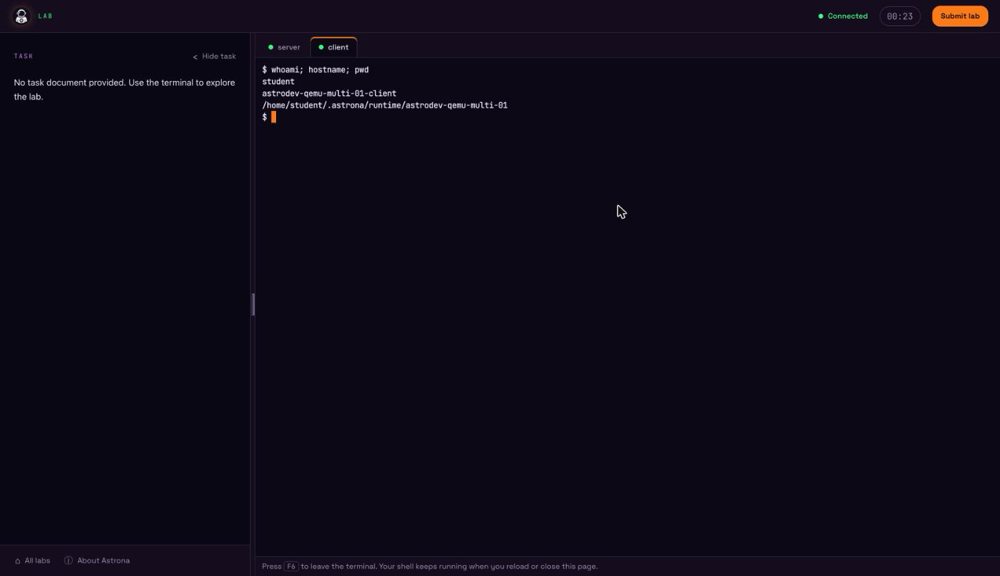
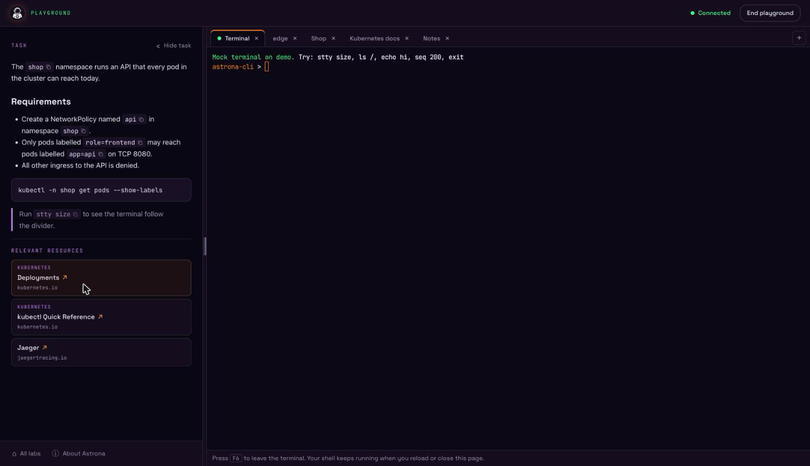
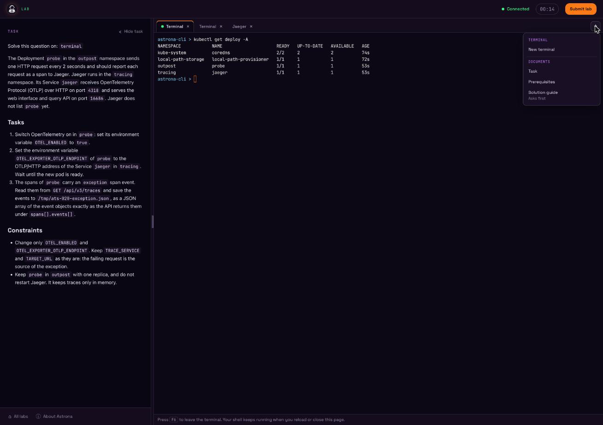
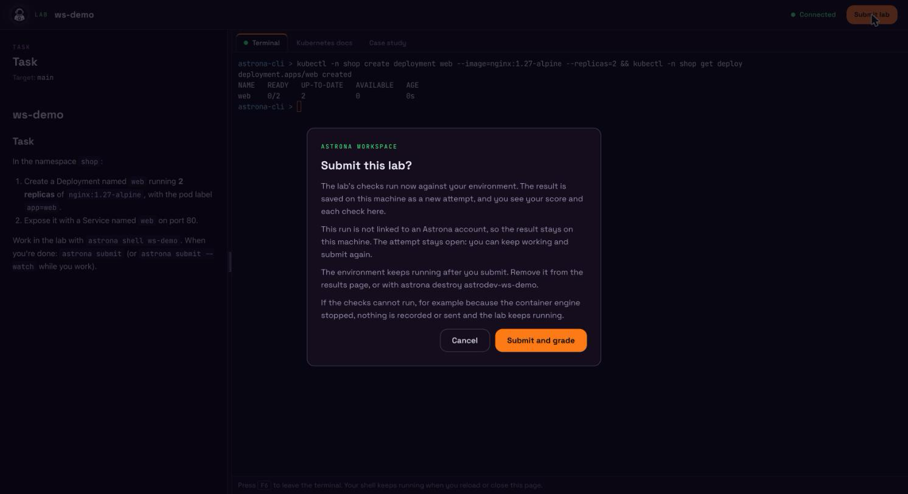
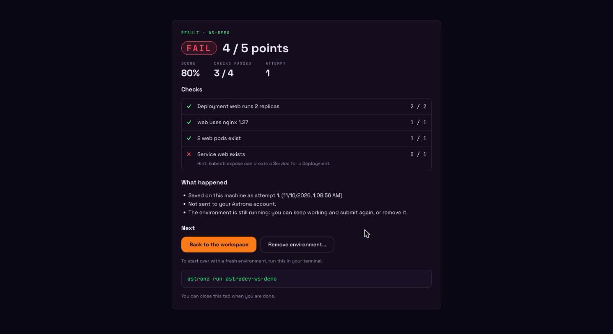

# Browser Workspace

The browser workspace is a local web page for working on a lab, Kind or QEMU: the task
on one side, a terminal on the lab on the other, in your own browser. `astrona`
serves the page itself, on `127.0.0.1` only; nothing leaves your machine. It
replaces the earlier terminal UI: `astrona ui` now opens this page.


## Open a lab in the browser

An interactive `astrona run` opens your browser as soon as it starts: it
starts the local workspace server (or reuses a running one), prints a link and
opens it in your default browser. You can follow everything from that tab:

1. **Terms.** When the [CLI terms](cli-terms.md) are not accepted yet, or have
   changed, the tab shows them in a dialog. **Accept and continue** goes on;
   **Decline and stop** stops the command before anything is downloaded or
   started. Nothing else happens, and no time counts, until you answer.
2. **Setup.** The tab shows each step in a terminal-style window, as the
   terminal does: what it is doing, ✓ / – / ✗ with how long each step took,
   and what a long step is waiting on. If setup fails, the tab shows the error
   and where the log is.
3. **The lab.** Once the lab is ready the tab says so and waits for you.
   Nothing counts yet. **Begin this session** starts the lab and opens the
   workspace straight away: the timer, and an exam's clock, start then. If the
   start fails, the intro page shows the error and a **Start** button to try
   again. A lab opened another way (`astrona ui`, *Labs on this computer*)
   still shows its intro page and starts on **Start**.

While the lab is set up, a card shows whether this run is saved to your
Astrona account. `astrona run` decides that when it starts the lab:

- **Signed in** (a catalog lab, signed in): *Signed in as <username> on
  <site>*. The time you spend and your submitted result, pass or fail, are
  saved to your account. Submitting ends the attempt and removes the lab. For a
  playground, the card only says that the time you spend in it is saved.
- **Not signed in** (a catalog lab, signed out): the run is not saved to an
  account; the time and your result stay on this computer. The card links to
  **Create a free Astrona account** on the site astrona signs in to (opened in
  a new tab) and tells you to run `astrona login` and start the lab again.
  Signing in while this run is open does not link it: a run is linked to an
  account only when `astrona run` starts.
- **Local only** (`--local-only`): nothing from the run is sent.
- A lab from your own files or `--git` has no account, and shows no card.

The intro page repeats this as one line, with the sign-up link when you are
not signed in.

Some questions are still asked in the terminal: whether to start a running lab
over, whether to log in, and whether to trust a lab's repository. The tab says
so while it waits. If you stop the command (Ctrl+C), the tab says that astrona
stopped. A QEMU lab opens the same way, with a terminal on each VM (see
[QEMU labs](#qemu-labs)).

The [`browser` setting](settings.md) changes this:

- `always` (the default) opens the browser first, as above.
- `never` keeps the command-line flow.
- `ask` sets the lab up in the terminal and then asks:

  ```text
  Open this lab in your browser? (yes/no/always/never):
  ```

  `yes` and `no` decide this run; `always` and `never` decide it and save the
  answer as the setting.

Decide one run with a flag:

```sh
astrona run ./labs/my-lab --browser      # open it, whatever the setting
astrona run ./labs/my-lab --no-browser   # keep the command-line flow
```

Without a terminal on stdin and stdout, the workspace is not opened unless you
pass `--browser`. On a machine without a browser (no display) the default and
`ask` keep the command-line flow; `--browser` or a saved `always` prints the
link and opens nothing. `--headless` never opens the browser.

The link is printed every time the workspace opens, so you can open it yourself:

```text
Continue in your browser: http://127.0.0.1:47300/#code=…&launch=…
Browser workspace: http://127.0.0.1:47300/#code=…&lab=my-lab
```

The first form is the browser-first run; the second is printed by
`astrona ui` and by the `ask` flow.

The `#code=` part is a single-use launch code that expires after two minutes.
It stays in the fragment, so it never reaches the server log or a referrer, and
the page removes it from the address bar after loading. If the tab you opened
first is closed by the time the lab is ready, astrona opens a new one. A link that was already
used, or is older than two minutes, shows **Link expired**: run
`astrona ui <lab>` (or `astrona ui status`) for a fresh one.

## Reopen a running lab

`astrona ui <lab>` opens a running lab again, for a link that expired or a tab
you closed:

```sh
astrona ui my-lab
astrona ui            # the only running lab; with none or several, every lab on this computer
```

It starts the workspace server if needed, prints a new link with a fresh code
and opens it (or prints it when there is no browser). It never restarts the lab
or its timer: an exam whose clock already runs keeps it, even when the lab was
started without the browser. It reads the saved local config and cached
repository; it does not check GitHub, update the checkout or rerun setup.

A lab named `status`, `stop` or `serve` is opened by its full name, since the
short name is a subcommand: `astrona ui astro-status` (`astrodev-status` for
development builds). `astrona list` shows the full names.

## Labs on this computer

A lab keeps running in the background after `astrona run` returns, until you
end it; a playground also ends when its time is up. Each one uses CPU and
memory, so it is easy to leave several running without noticing.

**Labs on this computer** lists every lab and playground running here, whether
or not it was opened in the browser: its title, Kind or QEMU, whether it is
running, how long it has been up and, for a playground, when it is deleted.
For a lab the workspace knows, **Open** opens it and **End playground** or
**Remove** removes it after the same confirmation as in the workspace. Other
labs show the command that opens or removes them. Labs that are stopped but not
removed are listed on one line below.

To get there:

- `astrona ui` with no lab name, when no lab or several labs are running;
- **All labs** at the bottom of the workspace's task panel;
- **See all labs on this computer** after a playground ended or a lab was
  removed.

The page refreshes every five seconds. When the container engine does not
answer, it says so, since Kind labs cannot be listed without it.

## QEMU labs

A QEMU (VM) lab opens in the browser like a Kind lab: the intro, **Start**, the
timer, **Submit** and **All labs** work the same way. Its terminals are SSH
logins into the VMs, as the lab's `student` user, starting in the lab's
workspace directory in the VM (`~/.astrona/runtime/<lab>`), the same login
`astrona ssh` gives you. There is no `kubectl` and no host shell.

- A single-VM lab has one **Terminal** tab on its VM.
- A multi-VM lab has one tab per VM, named after the VM. The first VM in the
  lab's config is the focus tab.



The VM tabs are fixed: a QEMU lab cannot declare [`tabs`](../reference/lab-config.md#tabs).
When a shell ends (`exit`), **Open a new shell** logs in to the same VM again.
The workspace connects with the lab's own key and known-hosts file only; it
never uses your SSH config, agent or keys. If the VM does not answer within 10
seconds, ssh gives up and the tab shows that the shell ended; nothing else is
started in its place.

`astrona run` still prints the `astrona ssh` command for each VM, and
`astrona status <lab>` shows them again, for a terminal outside the browser.

## Before you start

The first page shows the lab's prerequisites, its time limit and number of
questions, and the rules for an exam. **Environment ready** means the lab
finished setting up.


An exam's timer starts when you click **Start**, not when the lab is ready. From
then on it keeps running if you close the page or lose the connection; the top
bar counts down to the deadline. A lab in learning mode has no time limit, so
after **Start** the top bar counts up instead and shows how long you have spent
on it.

When the run is linked to your Astrona account, **Start** also starts the lab
session's time on astrona.io, with the moment you clicked, so you don't need to
open the lab page on the website. Offline, the start is saved on this computer
and sent once Astrona can be reached; it never holds up **Start**. A local-only
run sends nothing.

## The workspace

- **Task** (left): the question text, rendered from the lab's docs. Its
  top-level heading (such as `# Exam Question: <lab>`) is left out, since the
  panel already shows the task; the lab's name is in the browser tab's title.
  **All labs** and **About Astrona** sit at the bottom of the panel.
- **Copy**: every inline `code` in the task and in a docs tab carries a small
  copy icon; click it (or focus it and press <kbd>Enter</kbd>) to copy its
  text. A code block shows a **Copy** button in its corner. Both say
  **Copied** for a moment.
- **Relevant resources**: under the task, links to official documentation for
  the lab, taken from the lab's `resources` in the training's `astrona.yaml`
  (`- name: "Kubernetes: Deployments"`, `url: https://…`). The part of the
  name before the first `: ` is shown as a small product label, the rest as
  the title, with the site's host under it. Each link opens in a new browser
  tab. Only `https` links with a name are shown, at most 20; the section is
  hidden when the lab lists none, and it is never shown in an exam.
- **Terminal** (right): a shell on the lab with `kubectl` pointed at its
  cluster (on a QEMU lab, an SSH login into its VM; see [QEMU labs](#qemu-labs)). Keyboard focus moves into the terminal after **Start** and when the
  page opens. Press <kbd>F6</kbd> to leave the terminal; <kbd>Shift</kbd>+<kbd>F6</kbd>
  works too. The skip links at the top move focus between task and terminal.
- **Divider**: drag it, or focus it and use the arrow keys (<kbd>Shift</kbd> for
  bigger steps, <kbd>Home</kbd> / <kbd>End</kbd> for the limits). The task
  panel starts at 25% of the width and can take 15% to 70%; it never gets
  narrower than 280 pixels. The browser remembers the width you chose.
- **Hide task**: the button next to **Task** collapses the task panel to a
  thin rail, so the terminal gets the whole width. Click **Show task** on the
  rail (or use **Skip to task**) to show the task again; **All labs** (⌂) and **About** (ⓘ) stay at
  the bottom of the rail. The browser remembers this choice too.

When you are done, use **Submit** in the top bar (see
[Submit or end from the browser](#submit-or-end-from-the-browser));
`astrona submit` in a terminal does the same.



### Tabs

The right panel opens with the lab's tabs. The first, **Terminal**, is the
shell on the lab's own cluster. A lab can add more with
[`tabs`](../reference/lab-config.md#tabs): a terminal on a linked cluster, a
page the lab serves through one of its port forwards, or documentation.
Without `tabs` in the lab, the panel opens with only the **Terminal** tab.
You switch between tabs with the mouse or with the arrow keys and Enter.
Tabs keep running while another one is shown, so a terminal keeps its shell
and its scrollback. When a shell ends, **Open a new shell** starts another in
the same tab.

The **+** at the right of the tab bar opens more tabs:

- **New terminal**: another shell, the same kind as the first. In a lab with
  several VMs or clusters you pick which one (**New terminal on worker**). A
  lab has at most 12 terminals; at the limit the item is greyed out until you
  close one.
- **Task** and **Prerequisites**: the task and the prerequisites as a tab, for
  example next to a terminal when the task panel is hidden.
- **Solution guide**: the lab's full step-by-step solution. It asks first,
  because it shows the whole answer; your attempt still counts and nothing
  records that you looked. It is not offered in an exam (a lab with a time
  limit) or a playground.
- **Reopen**: any of the lab's own tabs you closed.



Every tab has an **×** (or press Delete on a focused tab) to close it. Closing
a terminal asks first and ends its shell: whatever runs in it stops and its
scrollback is gone, while your files and the lab's environment stay. The last
terminal cannot be closed, so there is always a shell. The open tabs are
remembered in this browser for the run, so a reload brings them back, and a
terminal you opened reattaches to its shell.

A page or documentation tab shows the page inside the workspace. **Back to
start** returns to the page the lab configured, wherever you navigated, and
**Open in new window** shows it in a separate window. Some documentation sites
refuse to be shown inside another page: if a tab stays blank, use **Open in new
window**.

### The terminal

The shell runs on your machine, held by the workspace server, not by the page:

- **Reload or close the page**: the shell keeps running. Opening the page again
  reattaches to it and replays its recent output.
- **Another tab**: opening the workspace in a second tab moves the terminal
  there. The first tab shows "This terminal was opened in another tab." with
  **Use it here** to take it back.
- **`exit`**: ends the shell. **Open a new shell** starts another one; files in
  the lab are kept.
- **Connection lost**: see below.

Output longer than the screen scrolls back like a local terminal: use the
mouse wheel or trackpad, drag the scrollbar on the right (shown once there is
history), or press Shift+Page Up / Shift+Page Down. The terminal keeps the last
5000 lines. The prompt line always sits above the hint bar at the bottom, and
the shell's size (`stty size`) follows the visible area when you resize the
window, hide the task or drag the divider.

The terminal draws with WebGL, so programs that use 24-bit ("truecolor")
colours show them. Where WebGL is not available, it falls back to a renderer
that shows those colours as the terminal's default colours; 16 and 256-colour
output looks the same either way.

### Connection lost

When the page cannot reach the workspace server for more than a second or two
(the server stopped or hangs, or the computer slept), a dialog covers the
workspace and the page behind it is blurred, so nothing typed goes into a
terminal that cannot receive it. It covers every tab, whichever terminal lost
its connection:


The page keeps reconnecting and shows the attempt number. The dialog cannot be
closed; it goes away by itself once the server answers, and you continue in
the same shells, with their output and the task as they were, and the keyboard
focus back where it was. Shorter drops do not show it.

If it does not come back, check with `astrona ui status` that the server is
running. If it is not, `astrona ui <lab>` starts it again and prints a new
link; the lab environment and its files are still there. A page from the
earlier server then shows **Session ended**.

With reduced motion or reduced transparency set in the system, the workspace
is dimmed rather than blurred.

### Submit or end from the browser

Browser submissions and removal use the same trust checks as CLI commands.
An official catalog lab needs no separate approval when its clean checkout
matches the commit published by Astrona. If that verification fails, the page
cannot approve code: submit from a terminal to review it. Removal skips
unapproved teardown scripts.

The top bar has one button to finish the session. Its label fits the run:

| Run | Button | What it does |
| --- | --- | --- |
| Lab | **Submit lab** | Grades it, as `astrona submit` does. |
| Exam | **Submit exam** | The same; the exam time is recorded at that moment. |
| Playground | **End playground** | Deletes it now. Nothing is graded. |

The button is disabled, with the reason next to it, when it cannot be used:
before **Start**, while a submission is being graded, or once the lab is no
longer running.

It always opens a dialog first that says what is about to happen for this run:

- The checks run and the result, pass or fail, is saved on this machine as a
  new attempt, with the time you spent.
- Where the result goes. A run linked to your Astrona account is sent to your
  lab page when astrona is signed in to the same site (or saved to send once
  Astrona can be reached). A local-only run is never sent. A run without a lab
  session keeps the result on this machine.
- That submitting is final. Every submit ends the attempt, pass or fail: there
  is no fixing the lab and submitting again. Check your work first with
  `astrona submit --watch` in a terminal, which grades without ending anything.
- That the environment is removed afterwards. Once the result is sent (or
  saved to send), or saved here for a run without a lab session, the cluster
  (or the VMs) and its terminals are removed. There is no option to keep them;
  `teardown.keepCluster` does not apply to a submit. Only a result Astrona
  refuses, or one that cannot be sent or saved, leaves the environment running.
- If the checks cannot run (for example, the container engine or a VM stopped),
  nothing is recorded or sent and the lab keeps running.



**Cancel** has the focus and **Esc** closes the dialog. While grading runs, the
dialog stays open. Keep the page open; if the connection drops, the page asks
the server for the result again, and the same submission is never graded
twice.

While the checks run, the dialog lists each one: waiting, running with the
time so far, or passed or failed with how long it took. A check that retries
for minutes shows as running rather than leaving the page looking stuck.

The results page shows pass or fail, the score, the pass mark, the attempt
number and every check with its points. A failed check shows its hint only when
the lab shows hints. Check commands and expected values are never shown, and
the solution only through **Solution guide** in the tab menu. Below that it says whether the result was saved and sent and whether
the environment was removed.



From there you can:

- go back to the workspace while the environment still runs;
- remove the environment (with a confirmation);
- start over with `astrona run <lab>` in a terminal.

When the time is up, a banner says so and offers **Submit**. Nothing is
submitted automatically. In a strict exam a submission after the deadline
cannot pass, and the terminal stops taking input at the deadline. Closing or
reloading the tab during a session or while grading asks for confirmation
first.

## The workspace server

The workspace server listens on `127.0.0.1` only. Its terminals are the same
isolated containers as `astrona shell`: they may only write the lab's own
workspace, and never see your home directory, container engine socket or
SSH agent. See [terminal workspaces](../concepts/runtimes.md#terminal-workspaces)
for file access and the protection boundary. The server stops by itself after
15 minutes without a page, terminal or running lab.

```sh
astrona ui status            # running?, a fresh link, pages and terminals
astrona ui status -o json
astrona ui stop              # stop the server and its terminals; labs keep running
```

After you update astrona, a browser-first `astrona run` replaces a server from
the earlier build when nothing uses it, since the older page cannot show setup
progress. If that server still has terminals or pages open, it is left alone,
setup is shown in the terminal only, and the run says so: `astrona ui stop`
ends it (labs keep running), and the next run starts the new one.

`astrona ui status` prints a new link with a fresh code each time.
`astrona ui stop` ends every browser terminal but leaves the labs running; an
open workspace then shows the connection-lost dialog. `astrona run` or
`astrona ui <lab>` starts the server again.

## Theme

The page follows your system's light or dark appearance. The terminal stays
dark in both: the tools a lab runs colour their output for a dark terminal.

## Security

The server only answers on `127.0.0.1`, refuses other `Host` and `Origin`
headers, and sends a Content Security Policy that allows no inline scripts or
styles. The page talks to it with a session token it gets in exchange for the
single-use launch code. See the [workspace API reference](../reference/workspace-api.md)
for the details.

## Guest login reminder

When you are not logged in, each lab run asks before starting the lab:

```text
Log in now? (yes = log in, no = continue as guest, never = continue as guest and stop asking):
```

`yes` opens the browser sign-in flow and continues startup when it completes.
`never` saves `login-reminder=no`. Catalog labs can track account progress after
login; local labs stay local. Restore reminders with
`astrona settings set login-reminder yes`. Noninteractive catalog runs still
require `--without-login` when signed out.

For automation, use [headless mode](ci-integration.md#headless-setup-for-external-checks):
`astrona run <lab> --headless` skips the browser question and login reminder and
returns after setup.

## History

Submission history uses the local results. Completed runs are recorded under
`~/.astrona/results/runs` (`~/.astrona-dev/results/runs` for development
builds). These records contain names, catalog identifiers and timestamps,
without credentials or session IDs, and survive destruction and cache cleanup.
`astrona progress` summarizes graded attempts.
