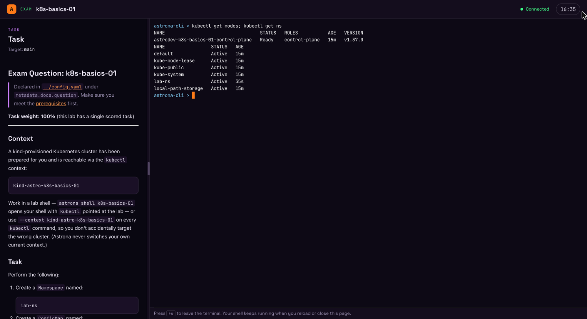
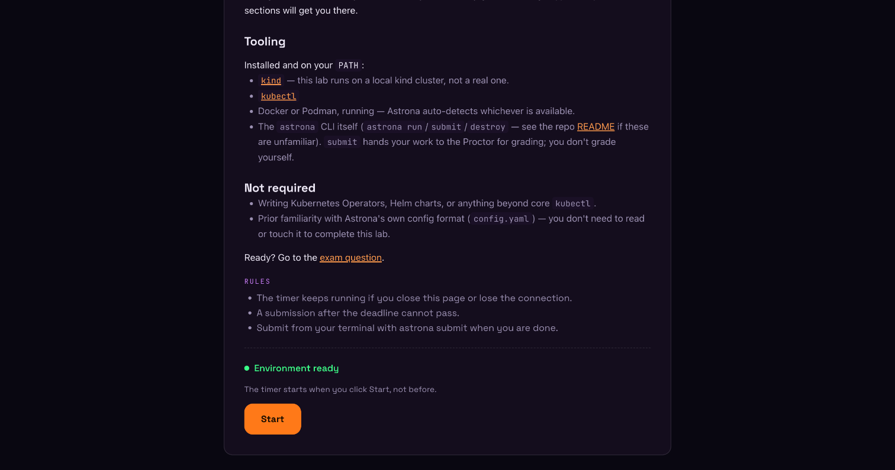
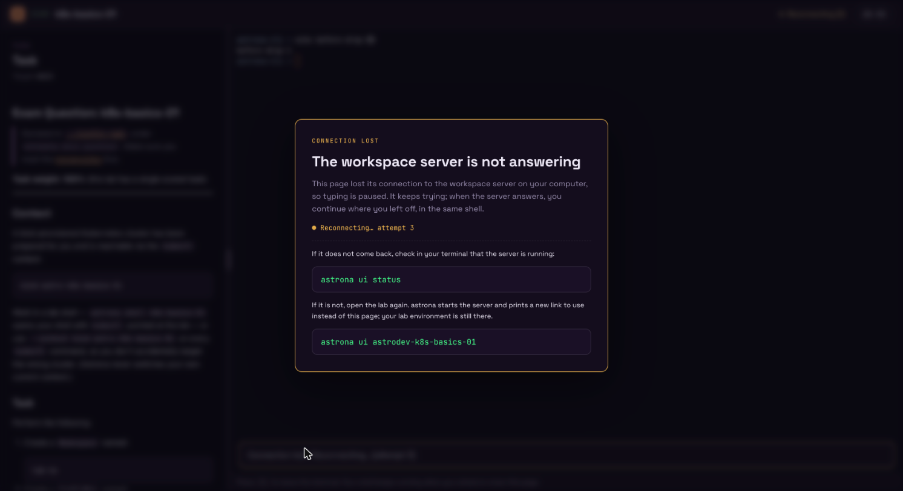

# Browser Workspace

The browser workspace is a local web page for working on a Kind lab: the task
on one side, a terminal on the lab on the other, in your own browser. `astrona`
serves the page itself, on `127.0.0.1` only; nothing leaves your machine. It
replaces the earlier terminal UI: `astrona ui` now opens this page.



## Open a lab in the browser

Once the trust prompt (if any) is settled, an interactive `astrona run` of a
Kind lab asks:

```text
Open this lab in your browser? (yes/no/always/never):
```

- `yes` sets the lab up as usual, then starts the local workspace server (or
  reuses a running one), prints a link and opens it in your default browser.
- `no` keeps the command-line flow.
- `always` and `never` answer the same way and save the answer as the
  [`browser` setting](settings.md), so later runs do not ask
  (`astrona settings set browser ask` asks again).

Answer in advance with a flag:

```sh
astrona run ./labs/my-lab --browser      # open it without asking
astrona run ./labs/my-lab --no-browser   # never open it, never ask
```

The question is only asked when stdin and stdout are a terminal; otherwise the
answer is no (unless you pass `--browser`). On a machine without a browser
(no display) nothing is asked; with `--browser` the link is printed and nothing
is opened. `--headless` never opens the browser.

The link is printed on every yes, so you can open it yourself:

```text
Browser workspace: http://127.0.0.1:47300/#code=…&lab=my-lab
```

The `#code=` part is a single-use launch code that expires after two minutes.
It stays in the fragment, so it never reaches the server log or a referrer, and
the page removes it from the address bar after loading. A link that was already
used, or is older than two minutes, shows **Link expired**: run
`astrona ui <lab>` (or `astrona ui status`) for a fresh one.

## Reopen a running lab

`astrona ui <lab>` opens a running lab again, for a link that expired or a tab
you closed:

```sh
astrona ui my-lab
astrona ui            # the only running lab; with several, it lists them
```

It starts the workspace server if needed, prints a new link with a fresh code
and opens it (or prints it when there is no browser). It never restarts the lab
or its timer: an exam whose clock already runs keeps it, even when the lab was
started without the browser. It reads the saved local config and cached
repository; it does not check GitHub, update the checkout or rerun setup.

A lab named `status`, `stop` or `serve` is opened by its full name, since the
short name is a subcommand: `astrona ui astro-status` (`astrodev-status` for
development builds). `astrona list` shows the full names.

## QEMU labs

QEMU (VM) labs do not open in the browser yet, and `--browser` on a QEMU lab is
an error. Once a QEMU lab is ready, `astrona run` prints the `astrona ssh`
command for each VM; `astrona status <lab>` shows them again.

## Before you start

The first page shows the lab's prerequisites, its time limit and number of
questions, and the rules for an exam. **Environment ready** means the lab
finished setting up.



An exam's timer starts when you click **Start**, not when the lab is ready. From
then on it keeps running if you close the page or lose the connection; the top
bar counts down to the deadline.

## The workspace

- **Task** (left): the question text, rendered from the lab's docs.
- **Terminal** (right): a shell on the lab with `kubectl` pointed at its
  cluster. Keyboard focus moves into the terminal after **Start** and when the
  page opens. Press <kbd>F6</kbd> to leave the terminal; <kbd>Shift</kbd>+<kbd>F6</kbd>
  works too. The skip links at the top move focus between task and terminal.
- **Divider**: drag it, or focus it and use the arrow keys (<kbd>Shift</kbd> for
  bigger steps, <kbd>Home</kbd> / <kbd>End</kbd> for the limits). The task
  panel starts at 25% of the width and can take 15% to 70%; it never gets
  narrower than 280 pixels. The browser remembers the width you chose.

Submit from a terminal with `astrona submit` when you are done.

### Tabs

The right panel shows the lab's tabs. The first, **Terminal**, is the shell on
the lab's own cluster. A lab can add more with [`tabs`](../reference/lab-config.md#tabs):
a terminal on a linked cluster, a page the lab serves through one of its port
forwards, or documentation. You switch between them with the mouse or with the
arrow keys and Enter; you cannot add or close a tab. Tabs keep running while
another one is shown, so a terminal keeps its shell and its scrollback. When a
shell ends, **Open a new shell** starts another in the same tab. Documentation
sites that refuse to be shown inside another page open in their own window
instead.

### The terminal

The shell runs on your machine, held by the workspace server, not by the page:

- **Reload or close the page**: the shell keeps running. Opening the page again
  reattaches to it and replays its recent output.
- **Another tab**: opening the workspace in a second tab moves the terminal
  there. The first tab shows "This terminal was opened in another tab." with
  **Use it here** to take it back.
- **`exit`**: ends the shell. **Open a new shell** starts another one; files in
  the lab are kept.
- **Connection lost**: see below.

The terminal draws with WebGL, so programs that use 24-bit ("truecolor")
colours show them. Where WebGL is not available, it falls back to a renderer
that shows those colours as the terminal's default colours; 16 and 256-colour
output looks the same either way.

### Connection lost

When the page cannot reach the workspace server for more than a second or two
(the server stopped or hangs, or the computer slept), a dialog covers the
workspace and the page behind it is blurred, so nothing typed goes into a
terminal that cannot receive it. It covers every tab, whichever terminal lost
its connection:



The page keeps reconnecting and shows the attempt number. The dialog cannot be
closed; it goes away by itself once the server answers, and you continue in
the same shells, with their output and the task as they were, and the keyboard
focus back where it was. Shorter drops do not show it.

If it does not come back, check with `astrona ui status` that the server is
running. If it is not, `astrona ui <lab>` starts it again and prints a new
link; the lab environment and its files are still there. A page from the
earlier server then shows **Session ended**.

With reduced motion or reduced transparency set in the system, the workspace
is dimmed rather than blurred.

## The workspace server

The workspace server listens on `127.0.0.1` only. Its terminals are the same
isolated containers as `astrona shell`: they may only write the lab's own
workspace, and never see your home directory, container engine socket or
SSH agent. See [terminal workspaces](../concepts/runtimes.md#terminal-workspaces)
for file access and the protection boundary. The server stops by itself after
15 minutes without a page, terminal or running lab.

```sh
astrona ui status            # running?, a fresh link, pages and terminals
astrona ui status -o json
astrona ui stop              # stop the server and its terminals; labs keep running
```

`astrona ui status` prints a new link with a fresh code each time.
`astrona ui stop` ends every browser terminal but leaves the labs running; an
open workspace then shows the connection-lost dialog. `astrona run` or
`astrona ui <lab>` starts the server again.

## Theme

The page follows your system's light or dark appearance.

## Security

The server only answers on `127.0.0.1`, refuses other `Host` and `Origin`
headers, and sends a Content Security Policy that allows no inline scripts or
styles. The page talks to it with a session token it gets in exchange for the
single-use launch code. See the [workspace API reference](../reference/workspace-api.md)
for the details.

## Guest login reminder

When you are not logged in, each lab run asks before starting the lab:

```text
Log in now? (yes = log in, no = continue as guest, never = continue as guest and stop asking):
```

`yes` opens the browser sign-in flow and continues startup when it completes.
`never` saves `login-reminder=no`. Catalog labs can track account progress after
login; local labs stay local. Restore reminders with
`astrona settings set login-reminder yes`. Noninteractive catalog runs still
require `--without-login` when signed out.

For automation, use [headless mode](ci-integration.md#headless-setup-for-external-checks):
`astrona run <lab> --headless` skips the browser question and login reminder and
returns after setup.

## History

Submission history uses the local results. Completed runs are recorded under
`~/.astrona/results/runs` (`~/.astrona-dev/results/runs` for development
builds). These records contain names, catalog identifiers and timestamps,
without credentials or session IDs, and survive destruction and cache cleanup.
`astrona progress` summarizes graded attempts.
