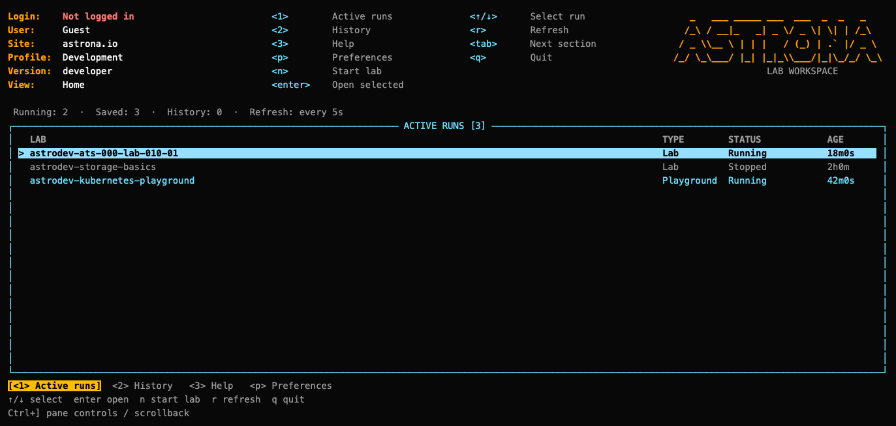

# UI home and lab workspace

Open the terminal home screen:

```sh
astrona ui
```

Home opens even when no labs are running or the container engine is offline.
The header uses a k9s-style layout: labeled status fields on the left,
keyboard shortcuts in columns, and an Astrona wordmark on wide terminals.
It stays visible during setup, grading and shell sessions. The status fields
show your login, account name, site, CLI version and active profile
(Development or Release). Shortcuts change for the workspace, shell and pane
controls. Small terminals use a compact header to leave room for content.
The UI rechecks terminal dimensions during startup and screen changes, so a
missed resize signal corrects itself without closing and reopening the UI.



A green **Logged in** means saved credentials have
an unexpired access token. Red **Not logged in** means there is no saved login
for the selected site. Expired credentials show **Login needs checking** in
amber; use `astrona whoami` to check and renew them, or `astrona login` to sign
in. An unreadable credentials file shows **Login unavailable**.

The header rereads local credentials every five seconds. It does not contact
the API or verify whether the server has revoked a login.

Home has three sections:

- **Active runs:** saved runs, their container or VM status and active time. Select
  a running Kind or QEMU lab or playground and press Enter to open its workspace.
  Stopped, missing or unavailable runs remain visible but cannot be opened.
- **History:** graded submission attempts, scores and completed local runs,
  including playgrounds. Select an entry and press Enter for details; Esc
  returns to the list. The latest UI action also appears here, including its
  result or error. The most recent 100 persistent entries are displayed;
  `astrona progress` summarizes all graded attempts.
- **Help:** controls, starting a lab, the current local profile and any errors
  encountered while reading run information.

The tabs below the content highlight the current section. Press `1` for Active runs,
`2` for History, `3` for Help, or `p` for Preferences. The summary below it
shows running and saved run counts, recent history count and refresh interval.
Tab also changes sections, arrow keys select entries, Page Up/Down scroll details,
`r` refreshes, `?` opens Help, and `q` or Ctrl-C closes Home. The screen refreshes
every five seconds. Closing Home leaves labs running and closes the UI's terminal tabs.

Ctrl+D on Active runs opens a red **Force delete** dialog for the selected
lab or playground. **No, keep running** is selected by default. Choose **Yes,
delete** with Tab, arrows or `y`, then press Enter to confirm. Esc or `n` cancels.
Force deletion discards work in the run and its linked clusters, skips teardown
scripts and `keepCluster`, and sends no results to Astrona. A run replaced while
the dialog is open must be selected and confirmed again.

Start a lab from the command line with `astrona run <lab> --ui`.
Home can open existing runs; creating a run from Home is not available yet.
Press `p` to edit Preferences, even with no active runs. Boolean settings use
`yes` / `no`; blank input keeps the current value.

Home shows a full-width table with Lab, Type, Status and Active time columns. Narrow
terminals retain Lab and Status. Long names are truncated within their column
so the status remains visible. The current row has a contrasting background.
The content has a single border, with centered titles and section tabs below.
Errors appear in an alert panel: Ctrl+G opens the full message,
Page Up/Down scrolls it, and Esc returns. Save confirmations use status panels.

## Time spent and idle pauses

Opening a lab workspace starts a local time spent counter. Keyboard input in
the workspace or its embedded shell counts as activity. After five minutes
without input, an idle dialog pauses the counter and excludes the idle interval
back to your last input. Press Enter on **Continue** to resume; that keypress is
consumed by the dialog. Output, polling and background commands do not count
as activity. The lab and commands keep running while the counter is paused.

Ctrl+C returns to Home and pauses the counter immediately. Terminal tabs and
background commands keep running, but their output does not add time. Reopening
the same run resumes tracking and restores its tabs.

Home shows container or VM status separately from activity: **Active** means at least
one UI is working in that lab; **Paused** means none is active. Watching Home
does not resume a timer. Other UIs refresh this state about every five seconds;
a crashed UI stops being considered active after 15 seconds.

The footer shows active time and whether it is paused. Home's Active column
and finished-run history retain the recorded time. Checkpoints are saved every
five seconds and on pause, resume and exit. Time with the UI closed is not
counted, and overlapping UI sessions are counted once. Older runs show a dash
until tracked; activity before opening the workspace is not reconstructed.

This tracks work in the terminal, so reading outside it will eventually pause
the counter. It does not extend exam limits or playground expiry deadlines,
and it does not send activity data to the API. Closing the UI abruptly may lose
up to five seconds since the last checkpoint.

## Work on a lab

Start a new lab and enter its workspace:

```sh
astrona run ./labs/my-lab --ui
```

If you omit `--ui`, an interactive run first offers the UI, before terms,
settings review or downloads. Press Enter or type `yes` to open it; `no`
continues with the command-line prompts. The offer explains that the UI will
become the default in v0.5.0. Use `--ui=false` to skip it. Runs with `--yes`,
CI jobs and redirected input/output keep the command-line flow without this
question. The UI supports Kind and QEMU labs.

Inside the UI, startup shows one Yes/No box before downloads or lab changes. Yes accepts the
displayed settings and CLI terms, authorizes the lab's code and required
downloads for this invocation, and continues with setup. Saved preferences
are kept. Catalog labs use your account when signed in; otherwise they run
without account progress tracking. Other labs stay running.

The UI stays open after Yes, with the dashboard behind a setup dialog.
Repository downloads, setup progress, later confirmations, grading and teardown
stay inside the dialog. A spinner and moving bar indicate work in progress;
the bar does not claim a percentage when the command cannot report one. Startup
errors stay visible until you press Enter or Esc to close the UI. The command's
exit code is preserved.

Press Ctrl+] for pane controls. Arrow keys and Page Up/Down scroll recent
output; End returns to the latest output, and Esc resumes input to the lab.
From pane controls, `q` asks before closing the UI and stopping its active
command. Any lab already created remains on your machine. Closing the UI does
not submit results or destroy the lab.

Use Tab to read the terms and setting explanations, arrow keys or Page Up/Down
to scroll, and left/right to select Yes or No. Enter confirms the selection;
`y` accepts directly. No, `n`, Esc or Ctrl-C cancels startup and prints a message.
Cancellation exits with code 3. No leaves existing labs as they are.

When the requested lab already exists, the box asks whether to destroy it
and start over. Yes discards work in that lab and its linked clusters without
saving or submitting it. The old account session is detached locally and its
playground watchdog is stopped without reporting to Astrona. The replacement
run stays local, even when signed in: it creates no account session and sends
no progress or submission results to the Astrona API. Grading still works
locally. Other labs stay running. The CLI skips teardown scripts during this
discard operation and blocks automatic version handover for the local run.

Saved runs are checked before the first notice. If an existing lab is only
found after its config is loaded, a restart confirmation appears then, before
any account access or deletion. A lab replaced by another command while the
dialog is open must be reviewed again. `--yes --ui` does not bypass this check.

You can open the UI from an Astrona lab shell. The inherited shell marker does
not choose which lab to replace; the command's lab argument or selected config
does. Startup leaves that shell's Kubernetes context unchanged. To continue
working on an existing lab without restarting, use `astrona ui <lab-name>`.

The startup notice cannot approve a remote config this CLI cannot parse.
Version handover still requires trust for that exact source or an explicit
`--trust` supplied after reviewing it.

Or open an existing lab directly:

```sh
astrona ui astro-my-lab
```

Development builds use `astrodev-` names and separate local data. Use the name
displayed by Home or `astrona list`.

Enter from Home opens the question/task on the left and one terminal tab on
the right. Kind shells use the lab's isolated kubeconfigs. QEMU terminals connect
to the VM over SSH as its student user and open an interactive POSIX shell.
Commands and editors stay inside the terminal pane.

| Key | Action |
| --- | --- |
| Ctrl+T | Name and open another terminal for the selected cluster or VM. |
| Ctrl+N / Ctrl+P | Switch to the next / previous terminal tab. |
| Ctrl+C | Return to Home and pause time spent. Tabs keep running. |
| Alt+C | Interrupt the active terminal command. |
| Ctrl+O | Switch focus between the task and terminal. |
| Page Up/Down, arrows | Scroll the task when it has focus. |
| Shift+Page Up/Down | Scroll the active terminal's output. |
| Ctrl+G | Open lab details, cluster or VM selection, results and submission controls. |
| Ctrl+Y | Toggle mouse text selection for copying. |

Function keys pass through to programs in the terminal; Astrona does not bind them.

On terminals narrower than 64 columns, Ctrl+O switches between the task and
terminal views. The task pane formats Markdown headings, lists, code blocks,
links and emphasis. Up to 12 terminal tabs are available per lab in one UI session.
Ctrl+T opens a name dialog. Type a name (up to 24 characters), then press Enter.
Leave it blank to use a default such as “Terminal 2”, or press Esc to cancel.
The dialog explains how to switch tabs with the mouse or Ctrl+N / Ctrl+P.
For QEMU labs, left/right arrows choose the VM before you open the new tab.

The task pane defaults to 30% of the lab view. Change **ui-task-width** in
Preferences (20–60%), or run `astrona settings set ui-task-width 25`. Drag the
vertical divider left or right to resize it for the current UI session. The
saved setting supplies the default when you open a new UI. Small terminals
keep enough space for the terminal, and Ctrl+O switches panes below 64 columns.

Embedded terminals show `astrona-cli >` in light blue with white input text.
Set `NO_COLOR=1` before starting Astrona to keep the prompt uncolored.
Kind terminals running Bash, Zsh or Fish keep their startup configuration;
Astrona replaces the prompt without editing your shell configuration files.

Click a terminal tab to switch to it. Type `exit` to close a shell and remove
its tab. Closing the last shell opens a replacement on the same cluster or VM.
If reconnection fails repeatedly, a Retry tab stays visible; press Enter to retry.
Closing other tabs frees slots for new terminals. Returning to Home
preserves shells and their environment until the UI closes or the run is deleted.

Press Ctrl+Y to select text with the mouse, then use your terminal’s usual Copy
shortcut (Cmd+C on macOS, often Ctrl+Shift+C on Linux). Press Ctrl+Y again to
restore tab clicks and divider dragging.

In lab details, arrow keys select a cluster or VM. Enter or `s` returns to the task
and terminals; Ctrl+T then opens a terminal for that target. Tab switches the
task/results panel, and Page Up/Down scrolls. `p` opens preferences. Settings
apply to future commands; cache policy is checked after the UI closes.

Press `g` in lab details to submit a graded lab and return Home. The lab stays
running after PASS or FAIL. Playgrounds do not offer submission. `q` opens the
exit menu, where you can leave running, submit, or request normal teardown.
Confirm normal teardown with `y`; Enter cancels that confirmation.

After a completed submission or successful destruction, Home shows the result
and refreshed runs/history. Errors before grading completes, failed
destruction, and `teardown.keepCluster` keep you in the workspace with an
explanation. Runs restarted elsewhere are blocked from workspace actions.

## History and availability

Submission history uses the existing local results. Newly completed runs are
recorded under `~/.astrona/results/runs` (`~/.astrona-dev/results/runs` for
development builds). These records contain names, catalog identifiers and
timestamps, without credentials or session IDs. They survive destruction and
cache cleanup. Older destroyed runs without a record cannot be reconstructed.

Home and the workspace require an interactive terminal outside CI. QEMU-only
runs do not require a container engine. A multi-VM lab stays accessible while
at least one VM is running; Home shows a degraded status when others stop.

Standalone `astrona submit` and `astrona destroy` keep their normal terminal
behavior. They do not automatically open Home. Closing a terminal never
submits or destroys a lab; existing lab/playground time limits still apply.

## CPU and memory

Inside a lab, the header shows CPU, memory and their averages immediately to
the left of the Astrona logo. Narrow terminals use a compact header. Home
keeps resource usage beneath its run list. Totals cover the selected lab,
including its node containers and linked clusters, or all its QEMU VMs. Averages cover valid samples
collected while a UI observes the run, including time when activity is paused.
They are sample means, not estimates for time when no UI was open. Concurrent
UIs share the local averages and contribute at most one sample every five seconds.
A fresh run starts fresh averages. These measurements are not sent to Astrona.

CPU uses the container engine's reported percentage and can exceed 100% across
cores. Memory uses the engine's reported usage. Missing, unsupported or incomplete
stats show as unavailable; they do not count as zero. Sampling supports Docker
and Podman Kind nodes and does not require Kubernetes Metrics Server.

For QEMU, CPU is the host process percentage reported by `ps`, and memory is
the resident host memory used by the VM processes. These are host measurements,
not guest CPU or guest memory statistics.

## Guest login reminder

Each guest lab run offers **Log in** or **Continue as guest** before starting the
lab. The **Never ask again** checkbox saves your choice to hide future reminders.
Tab or arrow keys move between the buttons and checkbox; Space checks it and
Enter accepts. Esc cancels startup without saving the checkbox.

Login opens the existing browser sign-in flow and resumes startup when complete.
With `--ui`, the reminder and sign-in progress stay in the UI. Catalog labs can
track account progress after login; local labs stay local. Explicit local-only
restarts keep API tracking disabled and skip the reminder.

Restore reminders with `astrona settings set login-reminder yes`, or change
**login-reminder** in Preferences. Noninteractive catalog runs still require
`--without-login` when signed out.
